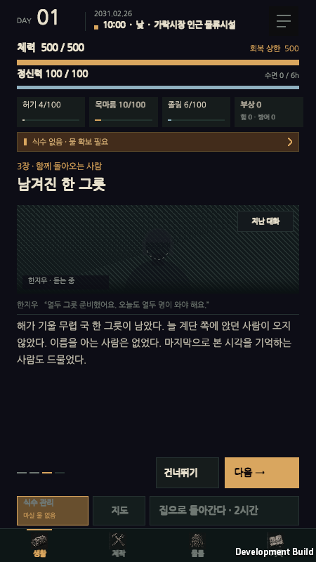
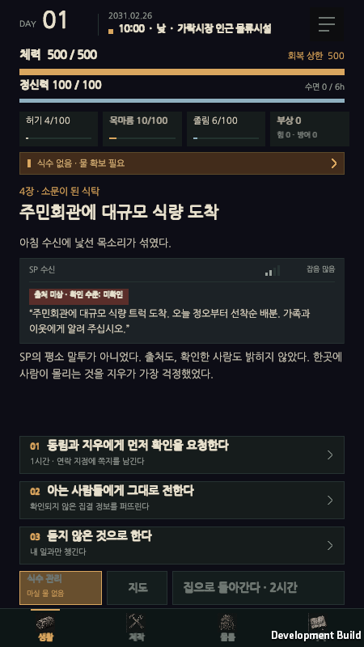
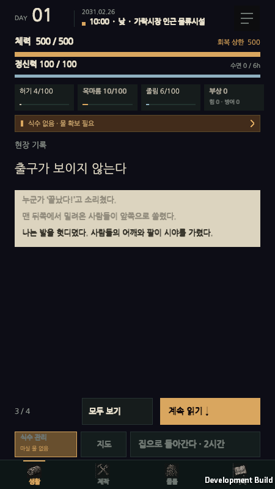

# 대사 연출 구현 기록

시안 캔버스(A 일지 · B 장면 대화 · C 무전·방송)에서 정한 규칙을 게임에 적용했다.

| 상황 | 연출 | 화면 |
|---|---|---|
| 사람과 직접 대화 | **B · 장면 대화** — 인물 초상, 한 줄씩 넘김, 직전 대사 흐리게, 진행 막대, 지난 대화 |  |
| 무전·방송 수신 | **C · 수신 기록** — SP 수신 헤더와 신호 막대, 출처·확인 수준 배지(녹), 잡음 줄, 무전 화자(차가운 청색) |  |
| 그 밖의 선택 장면 | **A · 일지** — 기록지 종이에 단락씩 적힘, 지난 단락 흐리게, `n / N`과 계속 읽기 |  |

## 판별 규칙

대본은 지금 쓰는 표기 그대로 읽는다. 데이터 변경은 없다.

- 빈 줄로 단락을 나눈다.
- `이름: “…”` → 대사. 플레이어 닉네임과 같은 이름이면 플레이어 대사.
- `[무전] 이름: “…”` → 무전 대화(앞으로 3막 「끊어진 길」 등에서 사용할 표기).
- `[출처 미상 · 확인 수준: 미확인]`처럼 **출처·확인 수준·제보자**가 들어간 대괄호 줄 → 방송. 다음 줄이 방송 내용.
- `[치직…]`, `[잡음…]` → 잡음 줄. `[SP 일일 수신 기록]`, `[정보 카드]` → 수신 기록의 소제목.
- `[3막 · …] DAY 12 …` 같은 이야기 안내는 대괄호로 시작해도 일반 서술로 둔다.

장면 하나에 대사가 하나라도 있으면 B, 대사 없이 방송·무전이 있으면 C, 둘 다 없으면 A다.
라디오·아침 수신함·소멸 속보·소멸 지도 상세는 항상 C다.

## 적용 화면

- B/A 자동: 후반 이야기 장면, 가락시장 사건(공황 A → 구조 B → 소멸 A → 동림 소개 B), 동림 만남, 동행 진행, 옆집 안부.
- A: 제보 장소 현장. 엔딩과 집·탐사 결과 기록지는 대사가 있으면 화자 칸이 붙은 일지로 표시한다(넘김 없음).
- C: 라디오 수신 기록, 아침 수신함, 소멸 속보, 전국 소멸 지도 상세, 후반 장면 중 방송만 있는 장면(거짓 집결 방송, 이석현 제보). C는 넘김 없이 바로 선택지가 보인다.

## 넘김 규칙

- 단락이 3개 이상인 B·A 장면은 한 단락씩 넘긴다. 2개 이하는 처음부터 전체를 보여준다.
- 끝까지 읽어야 선택지·버튼이 나온다. **건너뛰기 / 모두 보기**로 바로 끝까지 갈 수 있다.
- 다음 단락: 화면 탭(B), **다음 → / 계속 읽기 ↓** 버튼, Space·Enter.
- 다 읽은 장면은 이번 실행 동안 다시 열어도 선택지 상태로 열린다. 이때 마지막 줄이 보이도록 스크롤한다. 저장에는 넣지 않는다.
- B의 **지난 대화**는 지금까지의 대사를 화자 칸과 함께 보여준다.

## 인물 초상

`Resources/Art/Portraits/<id>.png`가 있으면 그 그림을, 없으면 인물별로 실루엣을 조금씩 다르게 그린 목탄 자리표시(`PortraitGraphic`)를 쓴다.
id: `donglim`, `jiwoo`, `seokhyeon`, `yeongsuk`, `neighbor`, 그 외 인물은 `stranger`. SP 기지국과 무전 너머의 목소리는 얼굴 없이 "무전 수신 중"으로 표시한다.
플레이어나 서술 차례에는 마지막에 말한 사람이 흐리게 남는다.

## 코드

- `Assets/Scripts/Survival/ScriptBlocks.cs` — 대본 분해, 연출 판별, 초상 id.
- `Assets/Scripts/DialogueInterface.cs` — `SceneText`(B/A 넘김·C 정적), 일지·장면·수신 기록 그리기, `-vdDialogue` 검증.
- `Assets/Scripts/Survival/PortraitGraphic.cs` — 초상 자리표시.
- `Assets/Editor/DialogueChecks.cs` — 실제 대본으로 판별 규칙을 검사(`PrototypeBuilder.Validate`에 포함).

## 검증 (2026-11-08)

- `PrototypeBuilder.Validate`: 기존 14종 + `DialogueChecks` 모두 통과.
- 검증 플레이어 `-vdDialogue`: 라디오(C) → 공황(A 넘김·선택지 숨김 → 다 읽은 뒤 선택지) → 구조(B 넘김·지난 대화) → 동림 소개 → 후반 방송 장면(C) → 후반 대화 장면(B) 통과. 스크린샷은 `Builds/DialogueVerification/`.
- 기존 UI 검사 `-vdLife`, `-vdQa`, `-vdInterfaceRepair`, `-vdTutorial`, `-vdBalance`, `-vdStorage` 통과. 자동 검사의 버튼 클릭은 숨겨진 선택지를 찾지 못하면 장면을 끝까지 넘긴 뒤 다시 찾는다. `-vdQa`의 방송 원문 검사는 수신 기록이 줄 단위로 나뉘었으므로 "모든 줄이 화면에 있는가"로 바꿨다.
- `-vdCraft`, `-vdErasure`, `-vdSupply`, `-vdSmoke`는 이번 변경 전 코드에서도 같은 지점에서 실패한다(변경을 빼고 다시 빌드해 확인). `-vdSmoke`는 새 게임 난수 시드에 따라 실패 지점이 달라진다.
- 5막 본편 연결 작업에서 이 네 검사도 현재 UI에 맞춰 갱신했고 모두 통과했다. [최신 검증 기록](StoryRestructure-v2.md#9-검증-기록)

## 본편 에셋

- 내장 ImageGen으로 동림·지우·석현·영숙·노인 초상을 한 장씩 제작해 `Assets/Resources/Art/Portraits/`에 적용했다. 낯선 화자에는 기존 실루엣을 쓴다.
- 공통 프롬프트는 2031년 서울 생존자의 정사각형 상반신, 어두운 배경, 거친 목탄과 흑연 해칭, 잿빛 종이 질감, 글자 없이 얼굴이 선명한 구도였다. 동림은 짧은 머리와 구조 작업복, 지우는 단발과 통신 헤드셋, 석현은 거친 머리와 작업 재킷, 영숙은 묶은 머리와 조끼, 노인은 흰머리와 카디건으로 구분했다.
- 대면 대사와 일지 본문은 나눔명조를 쓰고, 버튼·상태와 무전 기록은 나눔고딕을 쓴다. 글꼴과 OFL은 프로젝트 및 빌드에 포함한다. [나눔명조 원본](https://github.com/google/fonts/tree/main/ofl/nanummyeongjo)
- 3막 대본의 무전은 `[무전] 이름: “…”` 표기를 쓴다.


### 초상 생성 프롬프트

```text
Create a single square in-game dialogue portrait for the Korean text survival game Vanishing Days, set in a deserted Seoul in 2031. Subject: {person}. Framing: one head and shoulders, centered, face clearly legible and occupying most of the square; a little negative space around the hair. Restrained hand-rendered black charcoal and graphite on aged warm gray paper, rough hatch strokes, broad smoky shadows, paper tooth, documentary realism. Use charcoal gray, black, and neutral dusty gray only. Plain near-black charcoal backdrop with soft vignette. Character portrait asset, no scene, no frame, no lettering, no numbers or watermark.
```

| 파일 | `{person}` |
|---|---|
| `donglim.png` | a Korean man in his thirties, a civilian rescue worker, cropped black hair, tired steady gaze, worn rescue work jacket |
| `jiwoo.png` | a young Korean woman in her twenties, an alert communications dispatcher with short practical hair, worn zip jacket, looking up from a radio headset resting on her collar |
| `seokhyeon.png` | a Korean man in his thirties, a former independent video reporter, slightly unkempt hair, light stubble, dark utility jacket, watchful expression |
| `yeongsuk.png` | a Korean woman in her late fifties, a community kitchen volunteer, hair drawn back, practical padded vest over shirt, firm and approachable expression |
| `neighbor.png` | an elderly Korean man in his seventies, deeply lined face, wispy grey hair, worn sweater and cardigan, quiet attentive expression |
