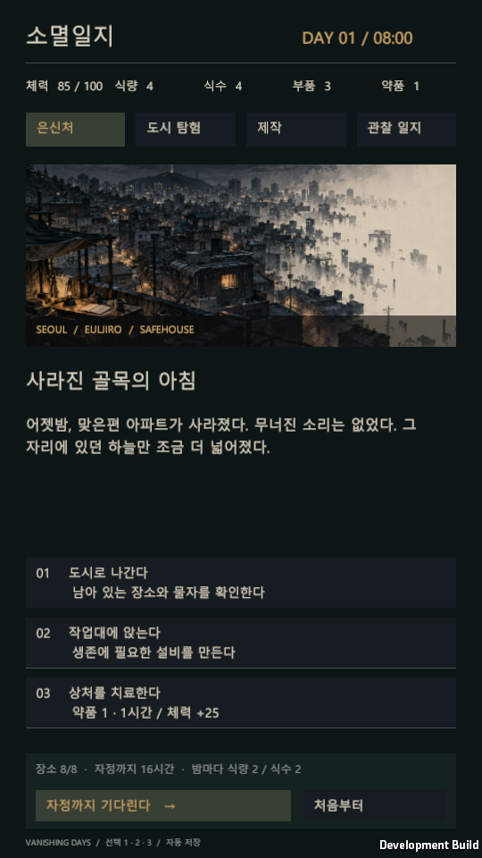

# 소멸일지 · Vanishing Days

Unity 6000.3.8f1 기반의 한국어 텍스트 생존 게임 프로토타입입니다.

화면은 **9:16 세로형**, UI 기준 크기는 900×1600, 기본 실행 창은 540×960입니다. Prototype 준비 시 Unity Game 뷰에도 9:16 비율을 적용합니다. 다른 비율의 창에서는 세로 화면 전체가 보이도록 여백을 둡니다.

## 실행

- Unity에서 `Assets/Scenes/Prototype.unity`를 열고 **Play**를 누르면 첫날 은신처에서 바로 시작합니다. `Vanishing Days - Prototype` 오브젝트가 게임 UI와 입력을 초기화합니다.
- 원래 타이틀부터 확인하려면 `SampleScene.unity`에서 Play를 누릅니다. Prototype의 Inspector에서 **Start In Shelter**를 꺼도 타이틀부터 시작합니다.
- 빌드가 있다면 `Builds/Windows/VanishingDays.exe`로 실행할 수 있습니다.
- Windows 빌드: Unity 메뉴 **Vanishing Days → Build Windows prototype**.
- 규칙 검증: **Vanishing Days → Validate game rules**.

## 플레이

7일 동안 생존하세요. 여덟 장소에서 물자를 수색하고, 설비를 제작하고, 소멸 징후를 관찰합니다. 매일 자정에는 장소 하나가 영구히 사라집니다. 밤마다 식량 2와 식수 2를 소비하며 부족하면 체력을 잃습니다. 정수기와 텃밭은 다음 날 아침부터 각각 식수와 식량을 생산합니다.

- **은신처**: 결과 확인, 치료, 다음 행동 선택.
- **도시 탐험**: 장소별 물자는 유한합니다. 안전 수색은 3시간, 전체 수색은 4시간과 체력 6을 소모합니다.
- **제작**: 정수기, 텃밭, 기록 송신기. 송신기를 제작하면 관찰 일지에서 오늘 보존할 장소를 고를 수 있습니다.
- **관찰 일지**: 마지막 방문, 징후, 소멸 결과를 비교하세요. 마우스 휠로 기록을 넘깁니다.
- 화면 아래 선택은 마우스 또는 숫자 **1 / 2 / 3**으로 실행합니다.

행동마다 `Application.persistentDataPath/vanishing-days-v1.json`에 자동 저장합니다. 종료 후 **이전 일지 이어 읽기**로 계속할 수 있습니다. 새 일지는 확인 화면을 거쳐 기존 저장을 교체합니다. 한국어 글꼴은 운영체제의 맑은 고딕 / Apple SD Gothic Neo / Noto Sans CJK KR을 사용하므로 해당 글꼴 중 하나가 필요합니다. Windows 환경을 기준으로 검증합니다.

## 구성

- `Assets/Scripts/SurvivalState.cs`: 상태, 유한 자원, 행동 비용, 제작, 결정적인 소멸 규칙, 승패.
- `Assets/Scripts/VanishingDaysGame.cs`: uGUI 인터페이스, 선택형 사건, 일지, 저장/불러오기.
- `Assets/Resources/Art/SeoulErasure.png`: 직접 생성해 적용한 서울 소멸 컨셉아트.
- `Assets/Editor/PrototypeBuilder.cs`: 규칙 검증 및 Windows 빌드.
- `Documentation/ConceptArt.md`: 원화 제작 정보.

이번 버전은 핵심 루프를 검증하는 7일 분량입니다. 물자, 방문, 제작과 보존 선택에 따라 결과가 바뀝니다. AI·시뮬레이션의 배후 설정은 플레이 화면에서 드러내지 않습니다. 사운드와 대규모 분기 서사는 아직 포함하지 않았습니다.

개발자용 소멸 규칙과 검증 방법은 `Documentation/Design.md`를 참고하세요.
